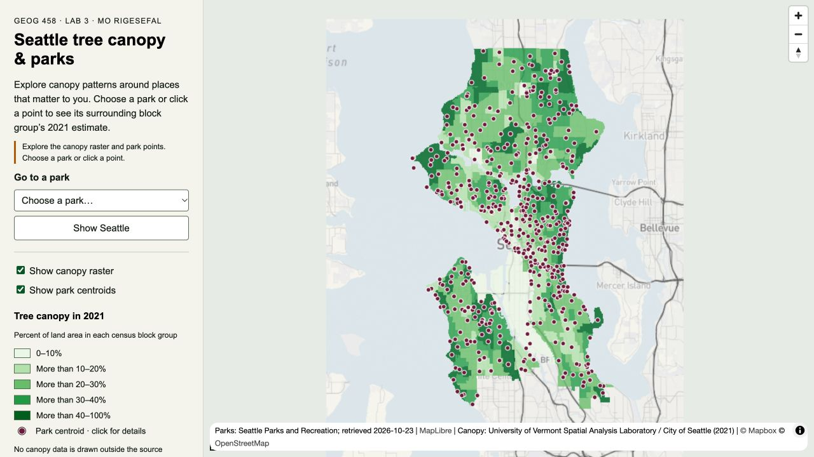
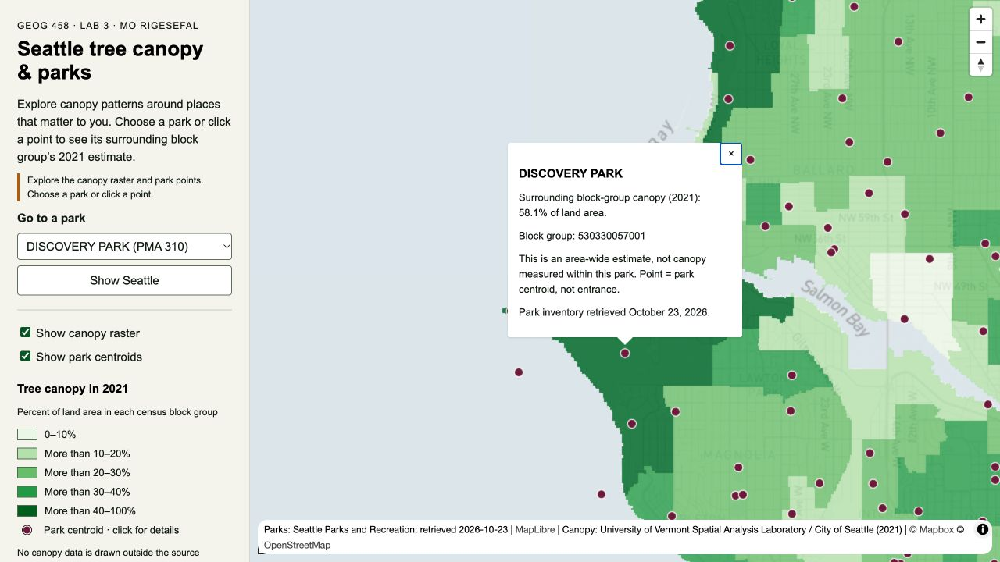
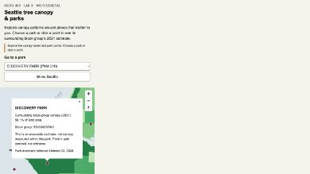

<h1 style="color:#000000">Seattle tree canopy and parks</h1>

GEOG 458 Lab 3 independent map · Mo RiGesefal · prepared October 23, 2026

This map pairs Seattle’s 2021 canopy estimates with related park centroids over a separately adapted basemap. Both raster pyramids and the complete interactive map are validated locally.

<h2 style="color:#000000">Purpose and study area</h2>

This map is for Seattle residents who want to explore broad tree-canopy patterns around places that matter to them. The thematic raster shows the City’s 2021 canopy estimate by census block group. Related park centroids help a user locate named places and inspect their surrounding block group’s estimate. The park selector provides another way to choose a place instead of relying only on pan and zoom.

The export covers Seattle: west −122.46°, south 47.48°, east −122.22°, north 47.75°. Both the independent basemap and canopy tiles must use that extent and zooms 8–13. Tiles are 256 × 256 PNGs in `{z}/{x}/{y}.png` XYZ order, rendered in EPSG:3857. The completed canopy pyramid has 96 tiles. The underlying source polygons cover a smaller, irregular land area; areas outside them remain transparent.

<h2 style="color:#000000">Sources and dates</h2>

| Layer | Source and field | Date / meaning |
|---|---|---|
| Canopy | [Seattle Tree Canopy 2016 2021 Block Groups](https://www.arcgis.com/home/item.html?id=c647921426ed423ca79b0703c0b855be), official City service layer 0, `TreeCanopy_2021_Percent` | 2021 canopy classification; 479 block-group features; source range 1.940744–60.819331% |
| Parks | [Park Boundaries](https://www.arcgis.com/home/item.html?id=9baab63b52df417a9b2a168e3f288b1b), official City service layer 0, “Parks Boundary Centroids” | 512 centroids; retrieved October 23, 2026; service data last edited October 22, 2026 |
| Basemap | Published Studio style lab3-seattle-canopy-morigesefal (`moooonster/cmvkokzsf00cv01sodrah6wf2`), water #dfe8ec and land #f6f5ef | 96 separate opaque 256 px XYZ PNGs at z8–13; [export evidence](qa/basemap-export.json) and [published style](source/mapbox-independent-style.json) |

Canopy credit: University of Vermont Spatial Analysis Laboratory for City of Seattle Office of Sustainability & Environment; published by City of Seattle Information Technology, Enterprise GIS Data. Park credit: City of Seattle, Seattle Parks and Recreation. Required basemap attribution is © Mapbox © OpenStreetMap contributors.

The official canopy metadata describes automated remote-sensing classification with manual edits and review, and states that no accuracy assessment was conducted. Source terms limit reliance to general mapping and disclaim guarantees of accuracy. The metadata and source terms are retained verbatim in `source/canopy-item.json` and `source/parks-item.json`. The [2021 Tree Canopy Assessment](https://seattle.gov/documents/Departments/OSE/Urban%20Forestry/2021%20Tree%20Canopy%20Assessment%20Report_FINAL_230227.pdf) is the publisher’s linked report.

<h2 style="color:#000000">Processing and classification</h2>

1. Download the two official ArcGIS REST layers as WGS84 GeoJSON. Compare the returned feature totals against independent service count queries; no transfer-limit truncation is accepted. Save the original responses, query URLs, timestamps, and SHA-256 hashes in `source/`.
2. Retain only map-relevant fields in the web GeoJSON. Use the source’s 2021 percent without rounding it for GIS processing. Validate that all 479 values are finite and within 0–100, and block-group IDs are unique.
3. Check the percentage denominator against all 479 source records. The formula is `TreeCanopy_2021_Area / TC_Land_A × 100`, and `TC_Land_A = Total_A − Water_A`. Both comparisons match within floating-point precision. Thus the legend says **percent of block-group land area**, not percent of total area including water.
4. Reproject the polygons to WGS84 / UTM zone 10N (EPSG:32610). Rasterize the percentage attribute on a 20 m, pixel-aligned grid using GDAL, retaining Float64 values and −9999 NoData. The result is a numerical GeoTIFF, not a standalone decorative image. The grid is 761 × 1,325 cells; 542,543 cells contain data.
5. In QGIS 3.44.15, style the raster as discrete pseudocolor classes: 0–10% `#edf8e9`; >10–20% `#bae4b3`; >20–30% `#74c476`; >30–40% `#31a354`; >40–100% `#006d2c`. Each upper boundary is inclusive. These deliberately simple 10-point breaks are a design decision, not statistical “natural breaks”; the last class contains the observed maximum of 60.82%.
6. Export with the installed QMetaTiles 1.5 renderer. Only the canopy raster is rendered, with empty-area transparency 100, PNG, 256 × 256, XYZ (TMS unchecked), extent and zooms above. The Mapbox background and park points are not baked into these thematic tiles. Keep the raster and project locally for reproduction.
7. Spatially join each park centroid to its containing source block-group polygon. 482 centroids have exactly one match. The remaining 30 have no containing polygon and keep null canopy values. No nearest-block-group estimate is substituted. This is an administrative area lookup, not a measurement of the park itself.
8. Display the canopy tiles above the separate local Mapbox tiles at 78% opacity, using nearest-neighbor raster resampling. Display purple park points above both raster layers. Independent layer toggles, a park selector, and name/date/value popups give users control over what they inspect. The selector distinguishes repeated park names with the source’s Property Management Area (PMA) identifier; the underlying data and popup names remain unchanged. The opening view and “Show Seattle” button fit the whole study rectangle using padding based on the map container’s actual dimensions. Raster source bounds remain exact; the camera can show surrounding space so the full study area fits different screen shapes.

The reproducible local process is `build_independent.py`; it uses the verified QGIS app’s Python wrapper and the installed QMetaTiles plugin. Set `GEOG_QGIS_APP` to the QGIS application location if it changes. QGIS project `seattle-canopy.qgz`, style `data/canopy-2021.qml`, and numerical raster `data/canopy_pct_2021_20m_utm10.tif` are local working files. Required web assets are the HTML, `data/parks.geojson`, the `assets/canopy-2021/` pyramid, the separate `assets/mapbox-independent/` pyramid, this README, provenance, and final screenshots.

<h2 style="color:#000000">Interpretation and limits</h2>

The raster records a classified canopy estimate summarized across each block group. Rasterizing it does not add information inside the group: all its cells inherit the same percent. A 20 m cell size is a rendering choice and does not establish 20 m measurement accuracy. Discrete geographic boundaries and class boundaries can make a continuous urban environment look more sharply divided than it is.

The park layer is a later inventory snapshot. Combining it with the 2021 canopy layer provides geographic context; it does not establish current canopy conditions, park-level canopy, walking access, opening hours, entrances, or a safe route. Some park centroids lie over water or outside the canopy polygons. Those retain “no estimate” popups. A park may extend across several block groups even when its centroid matches only one.

The map can support exploration and questions about canopy distribution. It cannot, from these two layers alone, demonstrate a causal relationship between parks and canopy, measure environmental inequity, or identify individual people’s heat exposure.

<h2 style="color:#000000">Validation and screenshots</h2>

The October 24 [independent audit](qa/2026-10-24-independent-audit.json) verified all 479 land-area denominators, reproduced all 512 park joins (482 unique matches and 30 nulls), and checked 5,000 fresh random numerical raster cells against source polygons. All 96 thematic PNGs pass grid, integrity, dimension and transparency checks. The separate [geographic tile audit](qa/2026-10-24-tile-geography-audit.json) found 5,391 interior tile pixels in the correct canopy class at the correct location; 2,461 boundary samples were excluded.

The independent basemap was exported on October 23, 2026 with QGIS 3.44.15 and QMetaTiles 1.5. Its 96 opaque, 256 × 256 PNGs have the exact extent and zoom range above. [Export validation](qa/basemap-export.json) records grid coverage, integrity, source/output comparisons and style-color checks. Two higher-difference tiles were inspected for QGIS line-edge resampling; geography and labels aligned. The thematic raster remains separate and transparent outside its source polygons.

Browser checks compare Discovery Park’s 58.1%, Gas Works Park’s 18.5% and Alki Beach Park’s missing estimate with the original joined values, then exercise controls, selectors, popup closing and full-area reset. The [QA index](qa/README.md) records the current review and identifies earlier thematic-only records as historical. Browser viewport testing does not establish physical-phone behavior.

Open [the independent page](https://tenzinmo.github.io/geog458-labs/lab3/morigesefal_lab3-2.html) in a browser, or serve this folder locally and open `morigesefal_lab3-2.html`. Deployment and remote verification are recorded separately. The [combined methods record](README.md) lists both maps and the submission URLs. Canvas submission remains pending.
