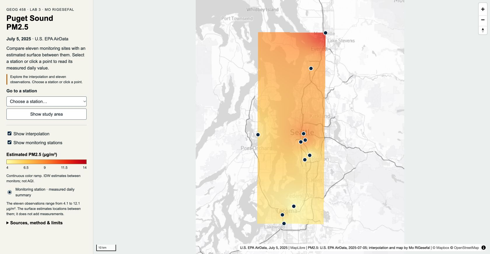
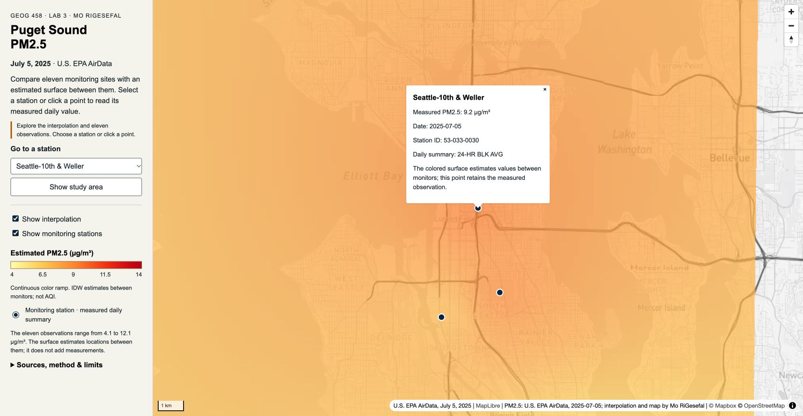
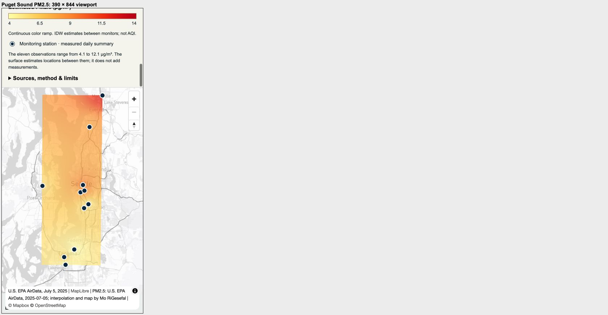
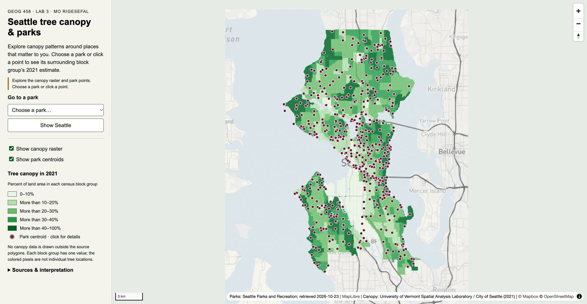
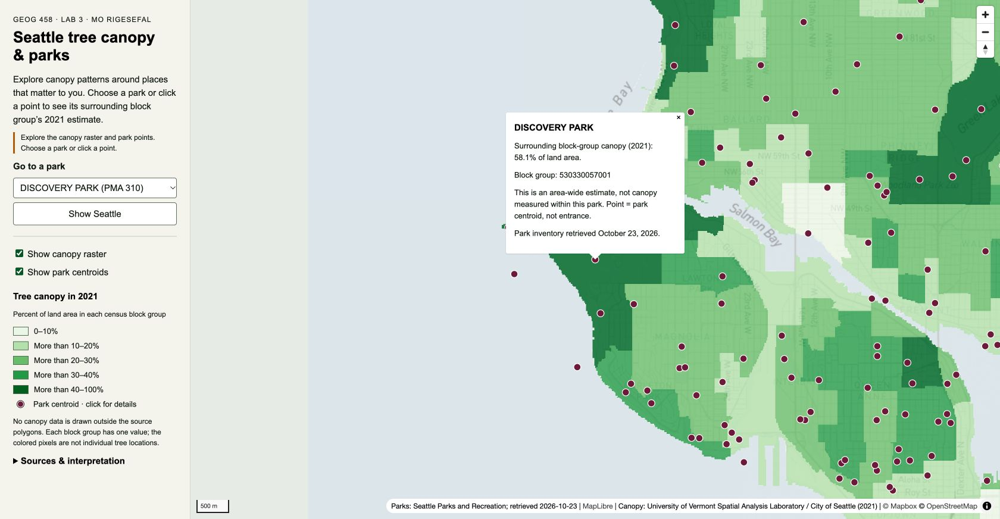
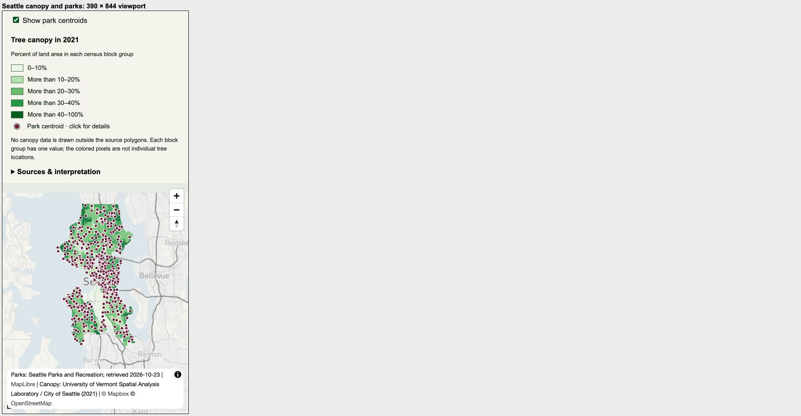

<h1 style="color:#000000">GEOG 458 Lab 3 — basemaps, PM2.5 and Seattle canopy</h1>

Mo RiGesefal · October 23, 2026

This project combines two basemap designs with separate thematic rasters and interactive vector data. The guided map explores measured and estimated PM2.5 across Puget Sound on July 5, 2025. The independent map relates Seattle’s 2021 block-group canopy estimates to named park locations.

The package contains four separately exported tile pyramids, 684 PNG tiles in total, and two locally verified interactive maps.

| Map | Map file | Current state |
|---|---|---|
| Guided: Puget Sound PM2.5 | [morigesefal_lab3-1.html](morigesefal_lab3-1.html) | PM2.5 IDW raster and original monitoring points |
| Independent: Seattle tree canopy and parks | [morigesefal_lab3-2.html](morigesefal_lab3-2.html) | Canopy raster and park-centroid interaction |

The two HTML pages use relative local tile/GeoJSON paths and MapLibre from its public CDN. The pages contain no Mapbox access token. Open them through a local web server, rather than directly as `file:` URLs, so GeoJSON and module requests can load. The map reports a missing-asset message if a required local source fails to load.

<h2 style="color:#000000">Guided map: Puget Sound PM2.5</h2>

The required map combines a quiet, individually adapted Studio basemap with a separate IDW estimate from eleven EPA monitoring stations on July 5, 2025. It should help a viewer compare broad estimated concentration patterns with measured station summaries while retaining geographic context. PM2.5 units are µg/m³; these values are not AQI scores.

The export extent is west −122.75°, south 47.10°, east −122.05°, north 48.15°; raster tiles use zooms 8–12, 256 × 256 PNGs, EPSG:3857 display and XYZ filenames. The GIS method uses EPSG:32610 projected station coordinates, QGIS IDW power 2, requested 250 m pixel size, and the station extent. QGIS fits the dimensions to the source extent, producing actual cells of 249.7964 × 249.7285 m. The generated numerical values range from 4.100431 to 12.099278 µg/m³, within the original observation range of 4.1–12.1. The numerical raster remains distinct from its styled PNG appearance and the original WGS84 station GeoJSON.

The continuous ramp uses 4, 6.5, 9, 11.5 and 14 µg/m³ with colors `#ffffb2`, `#fecc5c`, `#fd8d3c`, `#f03b20`, `#bd0026`. The HTML already includes the matching legend, 70% thematic opacity, separate surface/station switches and popups for station name, measured value, units, date and ID. Local browser checks passed for the actual observations, layer switches, matching legend, station selector, direct point click and full-area reset.

**Original source:** the course-provided [Canvas lab3-pm25-data.zip](https://canvas.uw.edu/courses/1918791/files/154562947). Its four original files are retained unchanged: [CSV observations](data/pm25_puget_sound_2025-07-05.csv), [WGS84 station GeoJSON](data/pm25_stations.geojson), [source metadata](data/pm25_source.json), and [supplied README](data/README-pm25-source.md). The ZIP and file hashes are retained in [the source and copy record](source/guided-package-copy.json).

The bundle records U.S. EPA AirData / AQS parameter 88101, downloaded October 18, 2026. It uses the July 5, 2025 local-standard-day 24-HR BLK AVG arithmetic mean, PM25 24-hour 2012 standard, no exceptional events, nonnegative values, and at least 75% observations. Where multiple instruments remain at one site, the supplied selection keeps the lowest eligible numeric POC; it does not average instruments. All eleven supplied rows have 100% observation completeness.

Source checks passed for eleven unique text station IDs, date, units, numeric range, WGS84 geometry, and CSV/GeoJSON agreement. QGIS created the numerical IDW raster and QMetaTiles exported 246 thematic PNGs at zooms 8–12 (4, 6, 15, 50 and 171 respectively). All images are 256 pixels with alpha support. Only the estimated surface is rendered in these tiles; station markers and the basemap remain separate. An independent computation projected all eleven original stations and evaluated the inverse-square weighted mean at every one of the 52,245 raster cell centers. [All cells matched](qa/guided-idw-numeric-check.json) within 0.00001 µg/m³; the maximum difference was 0.000000477 µg/m³, consistent with Float32 rounding. [Build evidence](qa/guided-build-manifest.json) records the source hashes, actual pixel size, range, ramp, extent and exporter.

These are historical measured daily summaries at eleven sites; the continuous IDW surface estimates values elsewhere, including parts of the rectangular station extent away from monitors. Apparent cell size does not establish measurement accuracy. This classroom map is not a current forecast, AQI product, health recommendation or regulatory assessment. The source README’s limits remain attached.

<h2 style="color:#000000">Independent map: Seattle tree canopy and parks</h2>

This map is for Seattle residents exploring broad canopy patterns around named places. The raster shows the City’s 2021 canopy estimate as percent of land area within each census block group. Park centroids provide related, geographically overlapping points with name/date/value popups and a selector. A centroid is neither a park entrance nor a boundary; its surrounding block-group value is not a park-level canopy measurement.

The export extent is west −122.46°, south 47.48°, east −122.22°, north 47.75°, using zooms 8–13. It contains 96 PNG tiles, each 256 × 256, in EPSG:3857 / XYZ order. A numerical Float64 GeoTIFF was rasterized from EPSG:32610 polygons on a 20 m grid, with −9999 NoData. The source field is `TreeCanopy_2021_Percent`; the denominator was checked against land area for all 479 source block groups.

QGIS discrete classes are 0–10%, >10–20%, >20–30%, >30–40%, >40–100%, colored `#edf8e9`, `#bae4b3`, `#74c476`, `#31a354`, `#006d2c`. QMetaTiles exported only the thematic raster with transparent empty areas; no basemap or park points were baked into it. The HTML applies 78% opacity and nearest-neighbor display. The 512 park centroids have 482 unique containing-block-group matches; thirty retain a null estimate. No nearest-area substitute is supplied.

The canopy classification is an estimate summarized over areas. Rasterizing it adds no new detail within each block group, and a 20 m cell is a display choice rather than a claim of measurement accuracy. The later park inventory supplies context, not evidence of current canopy or a causal relationship. See [the detailed independent method and limitations](README-independent.md).

<h2 style="color:#000000">Sources and attribution</h2>

| Source | Date and provenance retained here |
|---|---|
| [City of Seattle Tree Canopy 2016–2021 Block Groups](https://www.arcgis.com/home/item.html?id=c647921426ed423ca79b0703c0b855be) | 2021 values; [original response](source/canopy-original.geojson), [publisher metadata and terms](source/canopy-item.json), [layer schema](source/canopy-layer.json) |
| [Seattle Park Boundaries / Parks Boundary Centroids](https://www.arcgis.com/home/item.html?id=9baab63b52df417a9b2a168e3f288b1b) | Retrieved October 23, 2026; [original response](source/parks-original.geojson), [publisher metadata and terms](source/parks-item.json), [layer schema](source/parks-layer.json) |
| Public-service retrieval record | [Query URLs, timestamps and original hashes](source/retrieval.json); [denominator verification](qa/denominator-validation.json) |
| Guided EPA source | July 5, 2025; [original source metadata](data/pm25_source.json), [supplied README](data/README-pm25-source.md), [acquisition/hash record](source/guided-package-copy.json) |
| Mapbox Studio styles | [Published-style record](source/style-preparation.json); guided lab3-air-quality-morigesefal and independent lab3-seattle-canopy-morigesefal. [Basemap export evidence](qa/basemap-export.json) and published [guided](source/mapbox-guided-style.json) / [independent](source/mapbox-independent-style.json) style snapshots |

Canopy credit: University of Vermont Spatial Analysis Laboratory for the City of Seattle Office of Sustainability & Environment; City of Seattle Information Technology, Enterprise GIS Data. Parks: Seattle Parks and Recreation. Required basemap credit is © Mapbox © OpenStreetMap contributors. Source metadata and its limitations remain attached to the underlying data.

Provider terms were checked. Mapbox, OpenStreetMap and dataset attribution is retained with the relevant layers and sources.

<h2 style="color:#000000">Files and verification</h2>

```text
lab3/
  morigesefal_lab3-1.html
  morigesefal_lab3-2.html
  README.md
  README-independent.md
  CHECKLIST.md
  assets/mapbox-guided/{z}/{x}/{y}.png
  assets/mapbox-independent/{z}/{x}/{y}.png
  assets/canopy-2021/{z}/{x}/{y}.png
  assets/pm25-guided/{z}/{x}/{y}.png
  data/parks.geojson
  data/pm25_stations.geojson
  data/pm25_puget_sound_2025-07-05.csv
  data/pm25_source.json
  data/README-pm25-source.md
  source/                 original public source data and metadata
  qa/                     local verification and thematic preview
```

The layout contains all four separate pyramids and both vector layers: 246 guided basemap tiles, 246 PM2.5 tiles, 96 independent basemap tiles and 96 canopy tiles. QGIS projects and numerical working rasters remain in the local reproducibility workspace. The repository contains the web assets, original source records, methods and validation evidence.

<h3 style="color:#000000">Basemap export and final checks</h3>

The guided published style is `moooonster/cmvko96g200e101r73f81029u`; its five commercial POI exclusions preserve the original filter, and the road/bridge/casing/tunnel changes preserve widths, opacity and labels. The independent published style is `moooonster/cmvkokzsf00cv01sodrah6wf2`, with water `#dfe8ec` and land `#f6f5ef`. The two designs remain separate from the thematic rasters.

| Basemap export | Exact bounds west/south/east/north | Zooms | PNG count | Verified result |
|---|---|---|---|---|
| `assets/mapbox-guided/{z}/{x}/{y}.png` | −122.75, 47.10, −122.05, 48.15 | 8–12 | 246 | Opaque 256 px XYZ PNGs; complete coverage, integrity and alignment checks passed |
| `assets/mapbox-independent/{z}/{x}/{y}.png` | −122.46, 47.48, −122.22, 47.75 | 8–13 | 96 | Opaque 256 px XYZ PNGs; complete coverage, integrity and alignment checks passed |

Both basemap pyramids were rendered on October 23, 2026 with QGIS 3.44.15 and QMetaTiles 1.5. The QGIS XYZ provider read authentic PNGs cached separately for each published Mapbox style and production-style response hash. Only the basemap layer entered each export. Outputs use 256 × 256 PNG, EPSG:3857 display, XYZ row order and opaque alpha. The [export record](qa/basemap-export.json) retains source/style hashes and every output tile hash. Each rendered tile was compared with its source at the same z/x/y. QGIS resampling changes some line-edge pixels; three higher-difference tiles were individually inspected and retained with explicit review records. Geography, labels and intended style colors aligned.

<h3 style="color:#000000">Validation</h3>

The guided source checks confirm eleven unique text station IDs, consistent date/units, and matching CSV/GeoJSON coordinates and values. All 52,245 IDW cells match the independent inverse-square calculation within 0.00001 µg/m³. All 246 PM2.5 and 96 canopy PNGs pass dimensions, integrity and XYZ coverage checks. Two thousand sampled canopy raster cells match the source polygons, and all 479 source denominator checks pass.

Local thematic/vector browser checks pass for loading, source alignment, toggles, selectors, direct point popups and full-area reset. Guided popup comparisons match Marysville 12.1, Seattle–10th & Weller 9.2, and Tacoma–Alexander Avenue 4.1 µg/m³. Independent comparisons match Gas Works Park 18.5% and Discovery Park 58.1%; Alki Beach Park retains a null estimate. Both layouts were inspected in a 390 × 844 iframe; no physical-phone test is claimed. Evidence is retained in [guided browser checks](qa/guided-browser-review.json), [independent browser checks](qa/browser-review.json), [guided numeric checks](qa/guided-idw-numeric-check.json), and [canopy checks](qa/validation.json).

Both complete maps passed local browser checks for basemap alignment, intended colors and thematic contrast, all tile/vector loading, layer controls, selectors, popups and reset. The guided map retains all eleven stations and the independent map all 512 parks. Seattle–10th & Weller displays 9.2 µg/m³; Discovery Park displays 58.1%, matching their respective sources. No JavaScript warnings or errors were observed. The complete layouts were inspected at 390 × 844 in an iframe, including attribution visibility and popup closing. This is layout testing, not a physical-phone test. Results are recorded in [complete-map browser review](qa/complete-map-browser-review.json).

<h3 style="color:#000000">Guided map screenshots</h3>







<h3 style="color:#000000">Independent map screenshots</h3>







<h2 style="color:#000000">Deployment and submission</h2>

The [technical checklist](CHECKLIST.md) records the file and local validation results. The Canvas assignment is due **October 26, 2026, 11:59 p.m. Pacific**; availability until November 5 is not an extension.

Repository and map URLs:

- Repository: [tenzinmo/geog458-labs](https://github.com/tenzinmo/geog458-labs/)
- Guided page: [Puget Sound PM2.5](https://tenzinmo.github.io/geog458-labs/lab3/morigesefal_lab3-1.html)
- Independent page: [Seattle canopy and parks](https://tenzinmo.github.io/geog458-labs/lab3/morigesefal_lab3-2.html)

Open either map URL in a browser, or serve this folder locally and open the corresponding HTML file. Deployment and remote URL verification are recorded separately from the local checks above. Canvas submission requires the repository URL and both map URLs. **Canvas submission is pending; no receipt is recorded.**
